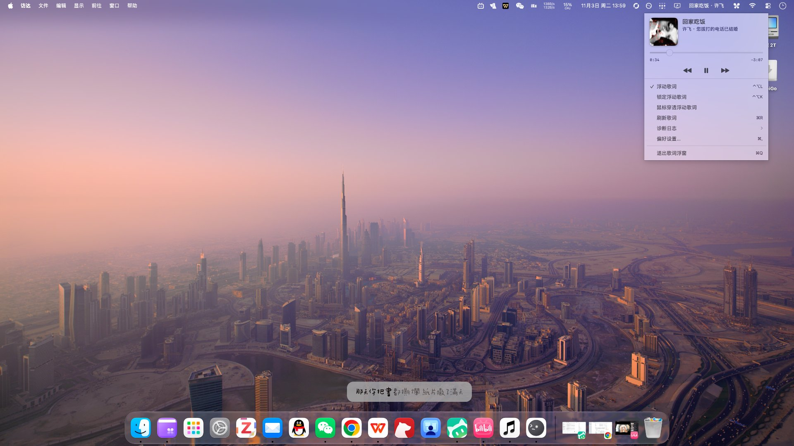

# LyricFeverDirect

macOS 上的单行歌词浮窗。歌词**直接取自 Apple Music 当前播放曲目自己的官方歌词**，不经过第三方歌词库、不联网、不需要 token。



## 能做什么

- **歌词直连 Apple Music**：读取「音乐」App 已缓存的官方同步歌词（逐行 / 逐字时间轴），跟着播放进度实时高亮、左→右扫光。Apple Music 没缓存就如实提示，不会拿外部歌词凑数。
- **单行胶囊浮窗**：只显示当前这一行，宽度随文字自动伸缩（短句就是小胶囊）；常驻最上层、跨所有虚拟桌面、不抢焦点、可拖动，可开启鼠标穿透。
- **切句平滑交接**：换句时尺寸变化与淡入淡出错开，不会出现背景框一闪变方。
- **完整外观自定义**：字体、字号（12–64pt）、字重、对齐、文字色 / 高亮色 / 背景色、圆角、内边距、最大宽度、投影、扫光、悬停淡出、显示下一句、锁定位置、鼠标穿透；另附 8 组配色预设，也可让配色自动跟随专辑封面。
- **菜单栏「正在播放」面板**：封面 + 歌名 + 艺人·专辑 + 上一首 / 播放暂停 / 下一首 + 可拖动进度条；功能行可开关浮窗、锁定、鼠标穿透、刷新歌词、查看诊断日志、打开偏好设置或退出。
- **菜单栏显示可配**：图标 / 歌名 / 歌手任意单选或多选；没播放时自动回退为图标，入口不会消失。
- **全局快捷键**：`⌃⌥L` 显示 / 隐藏浮窗，`⌃⌥K` 锁定 / 解锁位置（无需 App 处于前台）。
- **没播放就不打扰**：未打开「音乐」或没有正在播放的曲目时，浮窗保持隐藏。

## 怎么用

### 环境

- macOS 13+（Apple Silicon / Intel 通用）
- 系统「音乐」App + **Apple Music 订阅**（同步歌词仅对订阅者开放）
- 不需要 Xcode，不需要付费开发者账号

### 安装

```bash
./build.sh                 # 编译打包 + 固定身份签名，自动安装到 /Applications
./build.sh --no-install    # 只打包，产物留在 dist/LyricFeverDirect.app
```

想装到别的位置：`LYRIC_FEVER_INSTALL_DIR=/path/to/Applications ./build.sh`。

### 首次运行

1. 弹出「自动化」授权时允许本应用控制「音乐」。若误点拒绝：系统设置 ▸ 隐私与安全性 ▸ 自动化，或点菜单栏面板里的「⚠︎ 允许控制音乐」（设置页也有直达按钮）。
2. 播放一首 Apple Music 曲库里的歌，并在「音乐」中打开**一次歌词面板** —— 歌词由 Music 首次展示时下载，缓存写入后浮窗会自动跟上，无需手动刷新。

### 日常使用

打开「音乐」开始播放，菜单栏出现歌名，浮窗自动显示当前歌词；点菜单栏图标进入设置与播放控制，或用上面的快捷键。想让浮窗完全不挡鼠标，勾选「鼠标穿透」。出问题时看菜单栏 ▸ 「诊断日志」，或 `~/Library/Logs/LyricFeverDirect.log`。

> 本地导入的音频没有 Apple Music 官方歌词，会如实提示，不会偷换外部来源。

## 已知限制

- 依赖「音乐」App 的私有歌词缓存格式，macOS 大版本更新后可能需要适配；歌曲需先被 Music 缓存过歌词。
- 使用私有缓存路径，不能上架 Mac App Store（个人使用无碍）。
